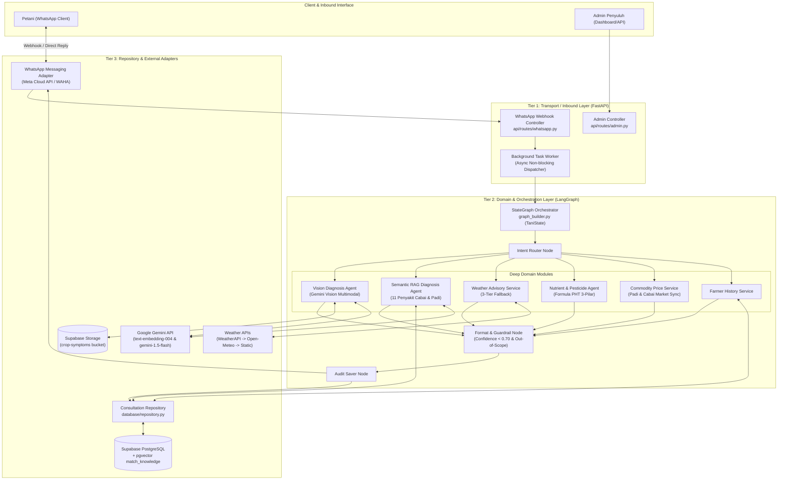
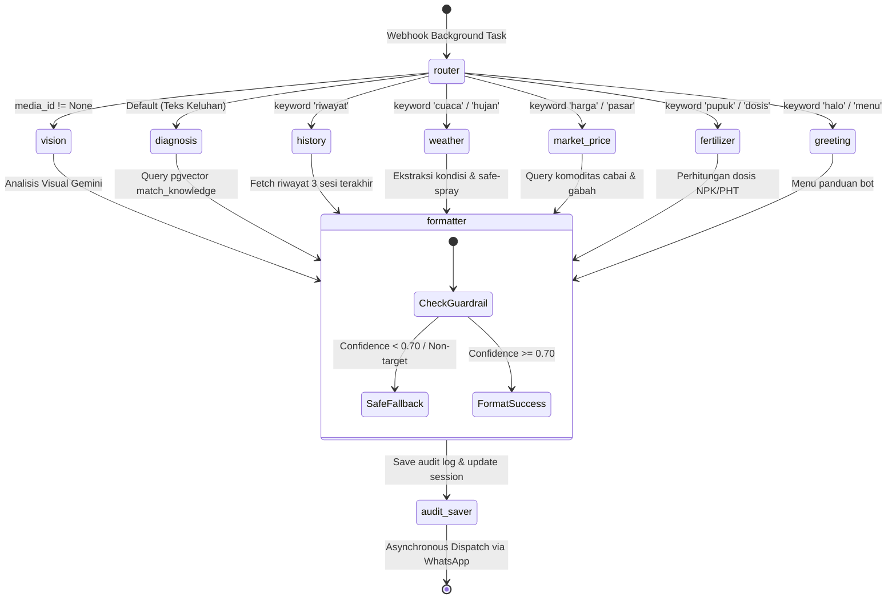

# 🏛️ Arsitektur Desain: TaniPintar WhatsApp Bot

Dokumen arsitektur sistem resmi asisten agronomis WhatsApp berbasis **LangGraph Multi-Agent Orchestration**, **RAG Semantik (pgvector)**, dan **Computer Vision**. Dirancang mengikuti prinsip *Deep Modules*, *Seams & Adapters*, serta *3-Tier Layer Invariance*.

---

## 1. 📐 Diagram Arsitektur Sistem Tingkat Tinggi



---

## 2. 🏗️ 3-Tier Architecture Invariance

| Lapisan | Direktori / File | Tanggung Jawab & Batasan |
| :--- | :--- | :--- |
| **Tier 1: Transport** | [`api/routes/whatsapp.py`](file:///e:/wa%20bot%20longchain/api/routes/whatsapp.py)<br/>[`api/routes/admin.py`](file:///e:/wa%20bot%20longchain/api/routes/admin.py)<br/>[`api/routes/health.py`](file:///e:/wa%20bot%20longchain/api/routes/health.py) | • Validasi token webhook Meta (`hub.challenge`).<br/>• De-duplikasi pesan (`_PROCESSED_MESSAGE_IDS`).<br/>• Parsing JSON HTTP & dispatch background task (< 200 ms).<br/>❌ *Dilarang query SQL langsung atau kalkulasi agronomis.* |
| **Tier 2: Domain** | [`graph_builder.py`](file:///e:/wa%20bot%20longchain/graph_builder.py)<br/>[`agents/diagnosis_agent.py`](file:///e:/wa%20bot%20longchain/agents/diagnosis_agent.py)<br/>[`agents/fertilizer_agent.py`](file:///e:/wa%20bot%20longchain/agents/fertilizer_agent.py)<br/>[`services/price_service.py`](file:///e:/wa%20bot%20longchain/services/price_service.py) | • State Management via [`TaniState`](file:///e:/wa%20bot%20longchain/graph_builder.py#L22-L36).<br/>• Klasifikasi intensi percakapan & routing logika.<br/>• Guardrail ambang batas keyakinan (`confidence < 0.70`).<br/>• Eksekusi 3-Pilar PHT (Mekanis, Sanitasi, Kimiawi terdaftar).<br/>❌ *Dilarang mengikat langsung ke HTTP controller.* |
| **Tier 3: Repository & Adapters** | [`database/repository.py`](file:///e:/wa%20bot%20longchain/database/repository.py)<br/>[`services/whatsapp_service.py`](file:///e:/wa%20bot%20longchain/services/whatsapp_service.py)<br/>[`services/weather_service.py`](file:///e:/wa%20bot%20longchain/services/weather_service.py)<br/>[`services/storage_service.py`](file:///e:/wa%20bot%20longchain/services/storage_service.py) | • Isolasi query Supabase & RPC `match_knowledge`.<br/>• Adapter upload/download binary image.<br/>• Adapter integrasi multi-provider (WeatherAPI, Open-Meteo).<br/>• Formatting payload WhatsApp Cloud API / WAHA. |

---

## 3. 🧩 Deep Modules & Seams Isolation

### A. Deep Module Contracts
1. **[`DiagnosisAgent`](file:///e:/wa%20bot%20longchain/agents/diagnosis_agent.py)**
   - **Antarmuka Minimal**:
     - `diagnose_text(query: str, crop_context: Optional[str]) -> DiseaseDiagnosisResult`
     - `diagnose_image(image_bytes: bytes, caption: str) -> DiseaseDiagnosisResult`
   - **Implementasi Tersembunyi**: Ekstraksi embedding (`text-embedding-004`), filter IVFFlat pgvector, prompt sanitization, format JSON terstruktur via Gemini Flash.

2. **[`WeatherService`](file:///e:/wa%20bot%20longchain/services/weather_service.py)**
   - **Antarmuka Minimal**: `get_weather_forecast(location: str) -> WeatherAdvisoryResult`
   - **Implementasi Tersembunyi**: 3-Tier fallback (Tier 1 WeatherAPI timeout 10s $\to$ Tier 2 Open-Meteo geocoding $\to$ Tier 3 Agronomic Static Fallback).

3. **[`ConsultationRepository`](file:///e:/wa%20bot%20longchain/database/repository.py)**
   - **Antarmuka Minimal**:
     - `search_knowledge_base(embedding, threshold, limit, commodity) -> list[dict]`
     - `save_consultation_audit(...) -> bool`
     - `get_farmer_consultation_history(phone, limit) -> list[dict]`
   - **Implementasi Tersembunyi**: Serialisasi payload, Supabase PostgREST client, penanganan fail-soft.

### B. Seams & Adapters (Isolasi Batas Eksternal)

```
[ Domain Core ]
       │
       ▼ (Interface Call)
┌────────────────────────────────────────────────────────┐
│                        SEAMS                           │
├────────────────────────────────────────────────────────┤
│ WhatsApp Seam : WhatsAppService (Meta Cloud API / WAHA)│
│ Storage Seam  : StorageService (Supabase S3 Bucket)    │
│ Database Seam : ConsultationRepository (Supabase RPC) │
│ Weather Seam  : WeatherService (WeatherAPI/Open-Meteo) │
│ LLM Seam      : DiagnosisAgent (Google GenAI SDK)      │
└────────────────────────────────────────────────────────┘
```

---

## 4. 🔄 State Lifecycle: LangGraph Execution Flow



---

## 5. 📊 Data Schema & Stable Contracts

### A. State Schema ([`TaniState`](file:///e:/wa%20bot%20longchain/graph_builder.py#L22-L36))
```python
class TaniState(TypedDict):
    phone_number: str
    user_message: str
    media_id: Optional[str]
    media_url: Optional[str]
    intent: Literal["diagnosis", "vision_diagnosis", "market_price", "history", "weather", "fertilizer", "greeting", "fallback"]
    crop_context: Optional[str]           # 'cabai' | 'padi' | None
    diagnosis_result: Optional[Dict[str, Any]]
    price_result: Optional[Dict[str, Any]]
    weather_result: Optional[Dict[str, Any]]
    fertilizer_result: Optional[Dict[str, Any]]
    history_result: Optional[List[Dict[str, Any]]]
    final_response: str
```

### B. PostgreSQL & Vector Store Contract ([`database/schema.sql`](file:///e:/wa%20bot%20longchain/database/schema.sql))
- `knowledge_base`: Tabel acuan 11 patogen utama (*Colletotrichum capsici*, *Magnaporthe oryzae*, dll.) dengan kolom vektor `embedding VECTOR(768)` dan index `IVFFlat` (kosinus).
- `consultation_audits`: Catatan telemetri diagnosa untuk audit verifikasi PPL lapangan.
- `disease_reference_images`: Galeri foto terverifikasi kementerian/balai tani untuk dikirim balik sebagai rujukan pembanding.
- `commodity_prices`: Tabel sinkronisasi harga pasar harian.

---

## 6. 🛡️ Guardrails & Keandalan Sistem

1. **Anti-Halusinasi Agronomis**:
   - Jika `confidence_score < 0.70` atau `is_supported_crop == False`, sistem memblokir rekomendasi kimiawi mandiri dan mengembalikan `SAFE_FALLBACK_MESSAGE` serta merujuk petani ke Penyuluh Pertanian Lapangan (PPL).
2. **Asynchronous Non-Blocking HTTP & Webhook Resiliency**:
   - Webhook Meta dan WAHA wajib merespons `200 OK` dalam `< 200ms`. Seluruh eksekusi LangGraph didelegasikan ke `BackgroundTasks` FastAPI.
   - Dilengkapi verifikasi cryptographic HMAC SHA-512 (`X-Webhook-Hmac`) untuk menolak request spoofing.
   - Engine WAHA menggunakan **GOWS** (Go + gRPC whatsmeow) yang hemat RAM (~40MB) dan memiliki session persistence auto-restart.
3. **Penyemprotan Aman (Weather Guard)**:
   - Rekomendasi penyemprotan otomatis membatalkan saran aplikasi pestisida bila peluang hujan $> 60\%$ atau kecepatan angin tinggi.
4. **Anti-Ban & Number Hygiene Guard**:
   - Filter otomatis mengabaikan pesan grup (`@g.us`), kanal (`@newsletter`), dan siaran status (`status@broadcast`) guna mencegah banned nomor akibat spam bot.
   - Menerapkan simulasi jeda mengetik alami (*human typing delay*) dan sanitasi Chat ID internasional (`628...@c.us`).
