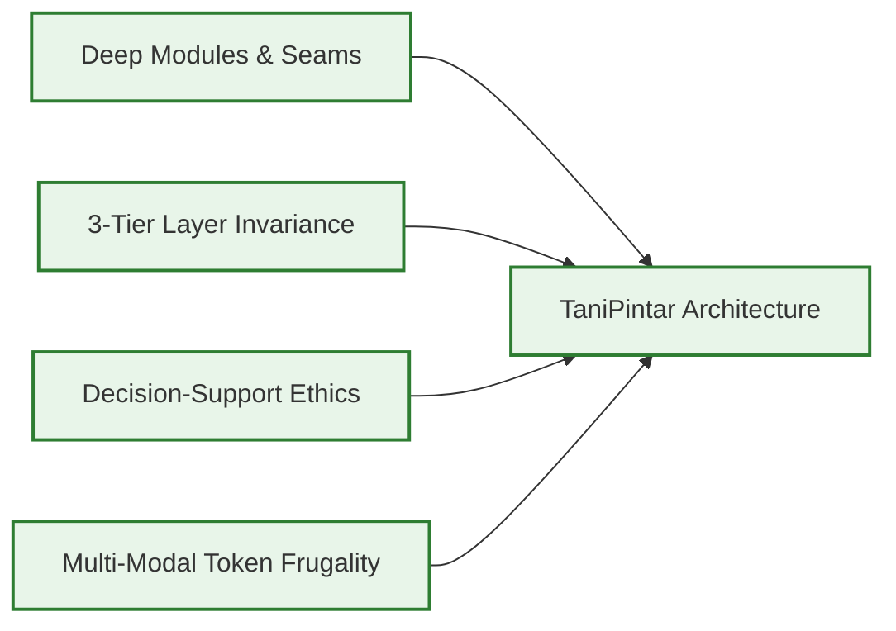
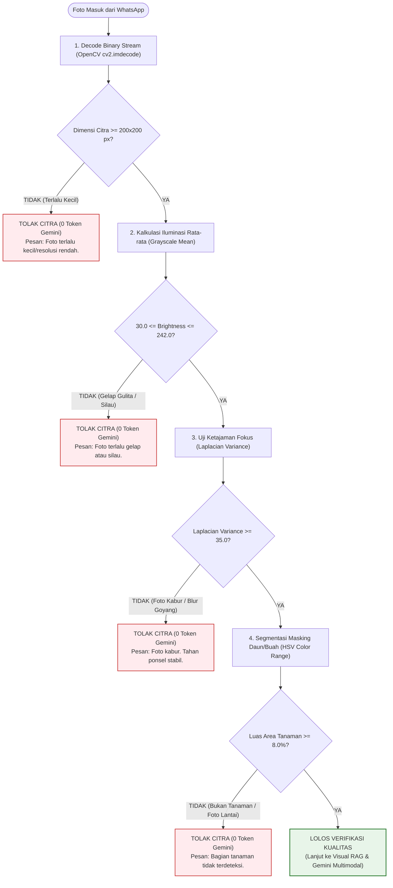
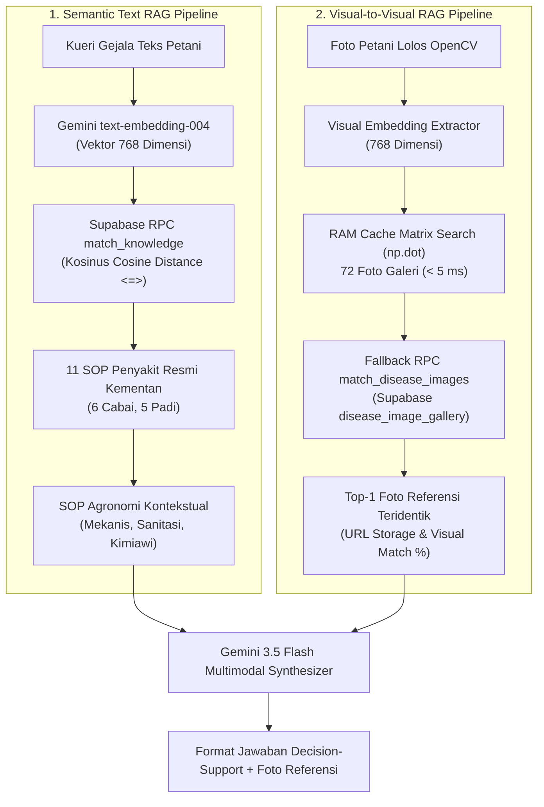
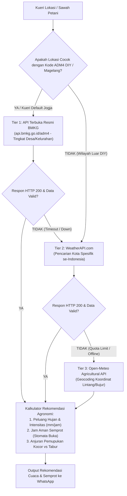
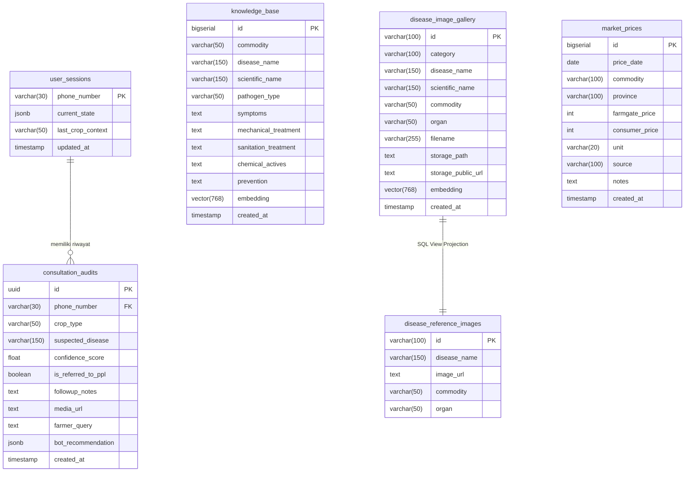
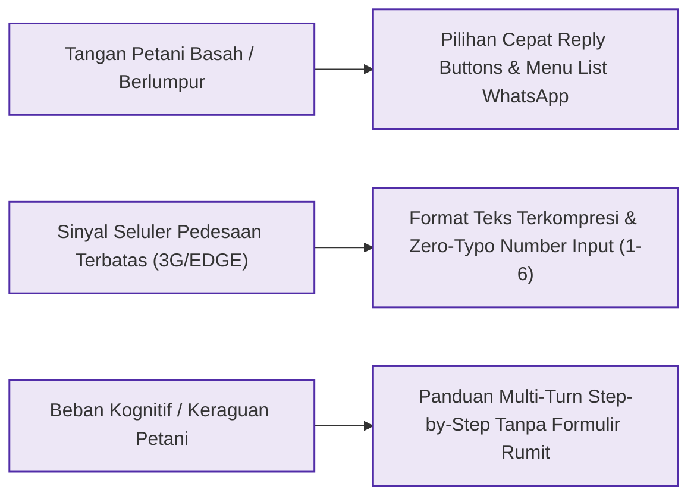
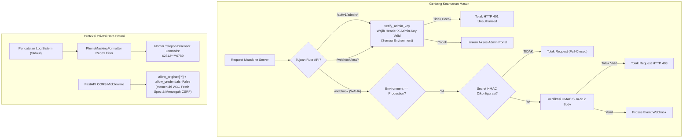

# 🏛️ Blueprint Arsitektur Sistem: TaniPintar Bot
**Dokumen Arsitektur Rekayasa Perangkat Lunak & Sistem AI Cerdas**  
**Proyek:** TaniPintar — WhatsApp AI Assistant Perlindungan Tanaman Cabai & Padi  
**Standar Rekayasa:** Clean 3-Tier Layer Invariance, Deep Modules, Reactive Dual-RAG, & PHT Framework  
**Pembaruan Terakhir:** 4 November 2026 | **Versi:** 2.0 (Production & Capstone 2 Ready)  

---

## 📑 Daftar Isi

1. [Ringkasan Eksekutif & Prinsip Desain Inti](#1-ringkasan-eksekutif--prinsip-desain-inti)
2. [Arsitektur Tingkat Tinggi (C4 Container Model)](#2-arsitektur-tingkat-tinggi-c4-container-model)
3. [Arsitektur Orkestrasi LangGraph (14-Node State Machine)](#3-arsitektur-orkestrasi-langgraph-14-node-state-machine)
4. [Pipeline Computer Vision & Gating Efisiensi Token](#4-pipeline-computer-vision--gating-efisiensi-token)
5. [Arsitektur Dual-RAG (Semantic Text RAG & Visual RAG)](#5-arsitektur-dual-rag-semantic-text-rag--visual-rag)
6. [Arsitektur Multi-Tier Weather Advisory](#6-arsitektur-multi-tier-weather-advisory)
7. [Arsitektur Data & Entity-Relationship Diagram (ERD)](#7-arsitektur-data--entity-relationship-diagram-erd)
8. [Ergonomi Interaksi Lapangan Petani](#8-ergonomi-interaksi-lapangan-petani)
9. [Arsitektur Keamanan & Privasi Petani (P0 Hardened)](#9-arsitektur-keamanan--privasi-petani-p0-hardened)
10. [Metrik Kinerja, Target SLA, & Pola Ketahanan Sistem](#10-metrik-kinerja-target-sla--pola-ketahanan-sistem)

---

## 1. Ringkasan Eksekutif & Prinsip Desain Inti

**TaniPintar Bot** adalah sistem asisten agronomis interaktif berbasis WhatsApp yang mengintegrasikan kecerdasan buatan multimodal untuk skrining hama/penyakit tanaman cabai dan padi, transparansi harga pasar harian, pemantauan cuaca mikrolokal pertanian, serta rekomendasi nutrisi pupuk dan pestisida berimbang.

Arsitektur sistem dibangun di atas 4 pilar rekayasa inti:



1. **Deep Modules & Seams Isolation**: Setiap agen dan servis memiliki antarmuka publik yang sangat ramping (*minimal contract*), menyembunyikan kompleksitas komputasi internal (OpenCV image matrix manipulation, embedding cosine distance calculation, multi-layer weather cascading).
2. **3-Tier Layer Invariance**: Pemisahan tanggung jawab yang kaku antara lapisan *Transport/Inbound* (FastAPI Webhook), lapisan *Domain/Orchestration* (LangGraph StateGraph), dan lapisan *Repository/Adapters* (Supabase PostgreSQL, pgvector, WAHA, dan Gemini API).
3. **Decision-Support Ethics (Anti Over-Claim)**: Sistem secara sadar dideklarasikan sebagai alat bantu skrining awal (*decision-support tool*). Output diagnosis tidak pernah mengklaim diri sebagai uji laboratorium definitif dan wajib menyertakan estimasi *Taraf Serangan* serta rekomendasi konsultasi fisik ke Petugas Penyuluh Lapangan (PPL).
4. **Multi-Modal Token Frugality**: Citra buram, gelap gulita, silau, atau bukan tanaman langsung dicegat oleh gatekeeper lokal OpenCV CPU (<15 ms) sebelum menyentuh cloud LLM, menghasilkan **penghematan 100% konsumsi token multimodal Gemini** untuk input yang tidak layak.

---

## 2. Arsitektur Tingkat Tinggi (C4 Container Model)

Arsitektur container sistem digambarkan dalam diagram C4 tingkat tinggi berikut:

```mermaid
flowchart TB
    subgraph Clients ["Aktor Pengguna"]
        Farmer["Petani Lapangan<br/>(WhatsApp Client)"]
        ExtensionOfficer["Petugas Penyuluh Lapangan / Admin<br/>(Browser / Admin API)"]
    end

    subgraph MessagingGateway ["WhatsApp Gateway Layer"]
        WAHA["WAHA Plus Container<br/>(Whatsmeow / GOWS Engine)"]
        MetaCloud["Meta WhatsApp Cloud API<br/>(Official Graph API v21.0)"]
    end

    subgraph AppServer ["Backend Application Server (FastAPI + Python 3.12)"]
        subgraph Tier1 ["Tier 1: Transport & Security Layer"]
            WebhookHandler["Webhook Route Handler<br/>(api/routes/whatsapp.py)"]
            AdminRoutes["Admin Management API<br/>(api/routes/admin.py)"]
            DedupEngine["Message Deduplicator<br/>(LRU Memory Cache)"]
            PhoneMasker["Privacy Log Formatter<br/>(core/logger.py)"]
            SessionManager["Session Service & Timeout Tracker<br/>(services/session_service.py)"]
        end

        subgraph Tier2 ["Tier 2: LangGraph Orchestration & AI Domain Layer"]
            GraphEngine["LangGraph StateGraph Engine<br/>(graph_builder.py - 14 Nodes)"]
            CVGatekeeper["OpenCV Vision Quality Gatekeeper<br/>(services/cv_preprocessor.py)"]
            VisualRAG["Visual RAG Cosine Engine<br/>(services/visual_rag_service.py)"]
            DiagAgent["Diagnosis Agent<br/>(agents/diagnosis_agent.py)"]
            FertAgent["Nutrient & Pesticide Agent<br/>(agents/fertilizer_agent.py)"]
            PriceEngine["Commodity Price Engine<br/>(services/price_service.py)"]
            WeatherEngine["3-Tier Weather Advisory Engine<br/>(services/weather_service.py)"]
        end

        subgraph Tier3 ["Tier 3: Repository & Service Adapters"]
            RepoLayer["Consultation Repository<br/>(database/repository.py)"]
            StorageAdapter["Supabase Storage Service<br/>(services/storage_service.py)"]
            WAService["WhatsApp Messaging Service<br/>(services/whatsapp_service.py)"]
        end
    end

    subgraph DatabaseCloud ["Supabase Managed Cloud Infrastructure"]
        PostgresSQL[("PostgreSQL 15+<br/>Relational Storage")]
        PgVectorExt[("pgvector Extension<br/>768-Dim IVFFlat Index")]
        ObjectStore[("Supabase Storage<br/>bucket: crop-symptoms")]
    end

    subgraph ExternalAPIs ["Ekosistem Layanan Eksternal"]
        GoogleGemini["Google Gemini API<br/>(gemini-3.5-flash & text-embedding-004)"]
        BMKG_API["API Terbuka BMKG Indonesia<br/>(adm4 Desa/Kelurahan)"]
        WeatherAPI["WeatherAPI.com<br/>(Global Secondary Fallback)"]
        OpenMeteo["Open-Meteo Agricultural API<br/>(Global Tertiary Fallback)"]
    end

    Farmer <-->|Kirim Foto & Teks / Terima Balasan| WAHA
    Farmer <-->|Kirim Pesan / Terima Balasan| MetaCloud
    ExtensionOfficer <-->|Audit & Manajemen Harga (X-Admin-Key)| AdminRoutes

    WAHA -->|Webhook Event (HMAC SHA-512)| WebhookHandler
    MetaCloud -->|Webhook Event (HMAC SHA-256)| WebhookHandler

    WebhookHandler --> DedupEngine
    WebhookHandler --> SessionManager
    WebhookHandler -->|Async Background Task| GraphEngine

    GraphEngine --> CVGatekeeper
    GraphEngine --> VisualRAG
    GraphEngine --> DiagAgent
    GraphEngine --> FertAgent
    GraphEngine --> PriceEngine
    GraphEngine --> WeatherEngine

    DiagAgent <--> GoogleGemini
    VisualRAG <--> PgVectorExt
    WeatherEngine <--> BMKG_API
    WeatherEngine <--> WeatherAPI
    WeatherEngine <--> OpenMeteo

    GraphEngine --> RepoLayer
    GraphEngine --> StorageAdapter
    GraphEngine --> WAService

    RepoLayer <--> PostgresSQL
    RepoLayer <--> PgVectorExt
    StorageAdapter <--> ObjectStore

    WAService -->|Kirim Pesan Interaktif / Media| WAHA
    WAService -->|Kirim Pesan Template| MetaCloud

    Tier1 -.-> PhoneMasker
```

---

## 3. Arsitektur Orkestrasi LangGraph (14-Node State Machine)

Alur percakapan dijalankan oleh [`StateGraph`](file:///e:/wa%20bot%20longchain/graph_builder.py#L911-L977) berstatus deterministik yang memetakan masukan petani ke dalam state terstruktur [`TaniState`](file:///e:/wa%20bot%20longchain/graph_builder.py#L26-L49).

### 3.1 Skema State Percakapan (`TaniState`)
```python
class TaniState(TypedDict):
    phone_number: str
    user_message: str
    media_id: Optional[str]
    media_url: Optional[str]
    intent: Literal[
        "diagnosis", "vision_diagnosis", "market_price", "history",
        "weather", "fertilizer", "greeting", "fallback",
        "photo_instruction", "disease_text_prompt", "price_prompt",
        "price_region_prompt", "weather_prompt", "fertilizer_prompt"
    ]
    crop_context: Optional[str]          # 'cabai' atau 'padi'
    conversation_history: Optional[str]  # Ringkasan multi-turn sebelumnya
    awaiting_location: Optional[bool]
    session_state: Optional[Dict[str, Any]] # Multi-turn state machine step
    diagnosis_result: Optional[Dict[str, Any]]
    price_result: Optional[Dict[str, Any]]
    weather_result: Optional[Dict[str, Any]]
    fertilizer_result: Optional[Dict[str, Any]]
    history_result: Optional[List[Dict[str, Any]]]
    is_first_interaction: Optional[bool]
    final_response: str
```

### 3.2 Diagram Alir Transisi StateGraph 14-Node

```mermaid
flowchart TD
    Start([Pesan / Foto Masuk]) --> RouterNode["1. router_node<br/>(Intent Classifier & User Context Priority)"]

    RouterNode -->|media_id != null| VisionNode["2. vision_node<br/>(CV Gate + Gemini Vision)"]
    RouterNode -->|intent == 'diagnosis'| DiagNode["3. diagnosis_node<br/>(Semantic SOP RAG)"]
    RouterNode -->|intent == 'market_price'| PriceNode["4. price_node<br/>(Daily Price Sync)"]
    RouterNode -->|intent == 'history'| HistNode["5. history_node<br/>(Farmer Consultation History)"]
    RouterNode -->|intent == 'weather'| WeatherNode["6. weather_node<br/>(3-Tier BMKG Forecast)"]
    RouterNode -->|intent == 'fertilizer'| FertNode["7. fertilizer_node<br/>(Nutrient & MoA Catalog)"]
    RouterNode -->|intent == 'greeting'| GreetNode["8. greeting_node<br/>(Interactive Menu Buttons)"]
    RouterNode -->|intent == 'photo_instruction'| PhotoInstNode["9. photo_instruction_node<br/>(Panduan Foto Efektif)"]
    RouterNode -->|intent == 'disease_text_prompt'| DisTextNode["10. disease_text_prompt_node<br/>(Panduan Keluhan Gejala)"]
    RouterNode -->|intent == 'price_prompt'| PricePromptNode["11. price_prompt_node<br/>(Pilih Komoditas)"]
    RouterNode -->|intent == 'price_region_prompt'| PriceRegionNode["12. price_region_prompt_node<br/>(Pilih Pasar Sentra)"]
    RouterNode -->|intent == 'weather_prompt'| WeatherPromptNode["13. weather_prompt_node<br/>(Tanya Wilayah)"]
    RouterNode -->|intent == 'fertilizer_prompt'| FertPromptNode["14. fertilizer_prompt_node<br/>(Pilih Fase Tanam)"]

    VisionNode --> Formatter["format_and_guardrail_node<br/>(Anti-Overclaim & Severity Est.)"]
    DiagNode --> Formatter
    PriceNode --> Formatter
    HistNode --> Formatter
    WeatherNode --> Formatter
    FertNode --> Formatter
    GreetNode --> Formatter
    PhotoInstNode --> Formatter
    DisTextNode --> Formatter
    PricePromptNode --> Formatter
    PriceRegionNode --> Formatter
    WeatherPromptNode --> Formatter
    FertPromptNode --> Formatter

    Formatter --> AuditSaver["audit_saver_node<br/>(Supabase Storage + Audit DB)"]
    AuditSaver --> EndNode([Selesai / Kirim ke WhatsApp])

    classDef router fill:#fff3e0,stroke:#e65100,stroke-width:2px;
    classDef worker fill:#e1f5fe,stroke:#0277bd,stroke-width:1.5px;
    classDef guard fill:#fce4ec,stroke:#c2185b,stroke-width:2px;
    class RouterNode router;
    class VisionNode,DiagNode,PriceNode,HistNode,WeatherNode,FertNode,GreetNode,PhotoInstNode,DisTextNode,PricePromptNode,PriceRegionNode,WeatherPromptNode,FertPromptNode worker;
    class Formatter,AuditSaver guard;
```



### 3.3 Fitur State Machine Unggulan
* **Asas Prioritas Konteks Petani (*User Context Priority Principle*)**: Jika petani secara eksplisit menyatakan koreksi komoditas (misal *"ini bukan cabai tapi daun padi"*), pernyataan petani secara absolut mengesampingkan inferensi visual sistem.
* **Auto-Reset Sesi 30 Menit**: Jika petani tidak mengirimkan pesan selama >30 menit, sesi lama diarsipkan dan pesan baru diawali dengan alert pembaruan sesi transparan sebelum menampilkan respon.

---

## 4. Pipeline Computer Vision & Gating Efisiensi Token

Untuk mencegah pemborosan kuota dan biaya API Gemini Vision Multimodal, citra fisik yang dikirimkan petani melalui WhatsApp wajib melewati **OpenCV Preprocessor Gatekeeper** di tingkat CPU lokal.



### 4.1 Parameter Kuantitatif Gatekeeper
| Metrik Kualitas | Ambang Batas | Metode Komputasi | Tujuan & Dampak Efisiensi |
| :--- | :---: | :--- | :--- |
| **Dimensi Minimum** | $\ge 200 \times 200\text{ px}$ | `image.shape[:2]` | Mencegah distorsi thumbnail WhatsApp beresolusi rusak. |
| **Batas Iluminasi** | $30.0 \le \bar{B} \le 242.0$ | `np.mean(cv2.cvtColor(img, COLOR_BGR2GRAY))` | Menolak foto malam tanpa lampu atau *overexposed* akibat flash berlebih. |
| **Ambang Ketajaman** | $\sigma^2_{\text{Laplacian}} \ge 35.0$ | `cv2.Laplacian(gray, cv2.CV_64F).var()` | Menolak foto goyang (*motion blur*) dari tangan petani. |
| **Proporsi Tanaman** | $\ge 8.0\%$ bidang | Segmentasi HSV Hijau & Kuning/Cokelat | Memastikan objek foto adalah dedaunan/buah, bukan wajah/lantai. |

> **Dampak Tokenomics:** Citra yang cacat ditolak dalam waktu $< 15\text{ ms}$ di CPU server lokal. Sistem menghemat **100% token Gemini** ($258 - 1.000+$ multimodal tokens terselamatkan per penolakan).

---

## 5. Arsitektur Dual-RAG (Semantic Text RAG & Visual RAG)

TaniPintar memadukan dua paradigma Retrieval-Augmented Generation secara simultan:



---

## 6. Arsitektur Multi-Tier Weather Advisory

Layanan cuaca [`WeatherService`](file:///e:/wa%20bot%20longchain/services/weather_service.py) menggunakan strategi failover 3-lapis untuk menjaga akurasi rekomendasi agronomi penyemprotan:



---

## 7. Arsitektur Data & Entity-Relationship Diagram (ERD)

Database Supabase PostgreSQL memadukan integritas relasional relasi pengguna dan vektor berdimensi tinggi:



---

## 8. Ergonomi Interaksi Lapangan Petani

Sistem antarmuka dirancang khusus untuk mengakomodasi realitas operasional petani di lahan sawah dan perkebunan:



1. **Reply Buttons & List Messages**: Memungkinkan pemilihan opsi menu utama, komoditas, dan pasar sentra hanya dengan 1 kali sentuhan jari.
2. **Dual Input Mode (Angka 1–6 vs Tombol Interaktif)**: Jika aplikasi WhatsApp versi lama petani tidak mendukung tombol interaktif (atau koneksi sinyal lemah), sistem secara otomatis beralih ke daftar teks bernomor yang dapat dijawab cukup dengan mengetik satu karakter angka (`1`, `2`, `3`).
3. **Optimasi Throughput Data**: Transmisi payload pesan WhatsApp dioptimasi agar tidak membebani kuota data seluler petani di pelosok sentra produksi pertanian.

---

## 9. Arsitektur Keamanan & Privasi Petani (P0 Hardened)

Lapisan keamanan dan privasi data telah diperkuat (*fail-closed*) guna memenuhi standar perlindungan data pribadi dan integritas sistem:



---

## 10. Metrik Kinerja, Target SLA, & Pola Ketahanan Sistem

### 10.1 Service Level Agreement (SLA) & Alokasi Latensi
| Komponen Arsitektur | Target SLA Latensi | Mekanisme Optimasi & Akselerasi |
| :--- | :---: | :--- |
| **Transport Webhook Response** | $\le 200\text{ ms}$ | FastAPI `BackgroundTasks` (ACK instan ke WhatsApp sebelum pemrosesan AI). |
| **OpenCV Quality Gatekeeper** | $\le 15\text{ ms}$ | Komputasi matriks C++ native via OpenCV Python tanpa alokasi memori berlebih. |
| **Visual RAG Cosine Search** | $\le 10\text{ ms}$ | Vektor 72 penyakit di-cache dalam RAM array `np.ndarray` float32 ternormalisasi. |
| **Semantic RAG pgvector** | $\le 350\text{ ms}$ | Indeks IVFFlat pada Supabase PostgreSQL dengan fungsi RPC terkompilasi. |
| **Gemini Multimodal Inference** | $\le 1.800\text{ ms}$ | Model terpilih `gemini-3.5-flash` dengan token budget terkontrol. |
| **Total Round-Trip Latency** | $\le 2.500\text{ ms}$ | Pipeline terpadu siap melayani petani dalam hitungan detik. |

### 10.2 Pola Ketahanan (*Resilience & Failover Matrix*)
* **Supabase Offline Fallback**: Sistem memiliki *graceful degradation* berbasis memori lokal. Jika Supabase tidak merespon, sistem menyajikan katalog pupuk terintegrasi di RAM dan variansi harga deterministik sehingga bot tidak pernah berhenti melayani petani.
* **Penyedia Cuaca Bertingkat**: Kerusakan pada server BMKG otomatis dialihkan ke WeatherAPI dan Open-Meteo tanpa interupsi pada sesi chat.
* **Pencegahan Re-entrancy & Dedup**: ID pesan WhatsApp dicatat pada cache LRU memori untuk mencegah eksekusi ganda saat jaringan seluler petani melakukan transmisi ulang paket (*network re-transmit*).

---

*Dokumen ini merupakan arsitektur acuan resmi (Source of Truth) untuk implementasi kode, pengujian integrasi berkelanjutan, serta penyusunan laporan akademik Capstone 2 TaniPintar Bot.*
