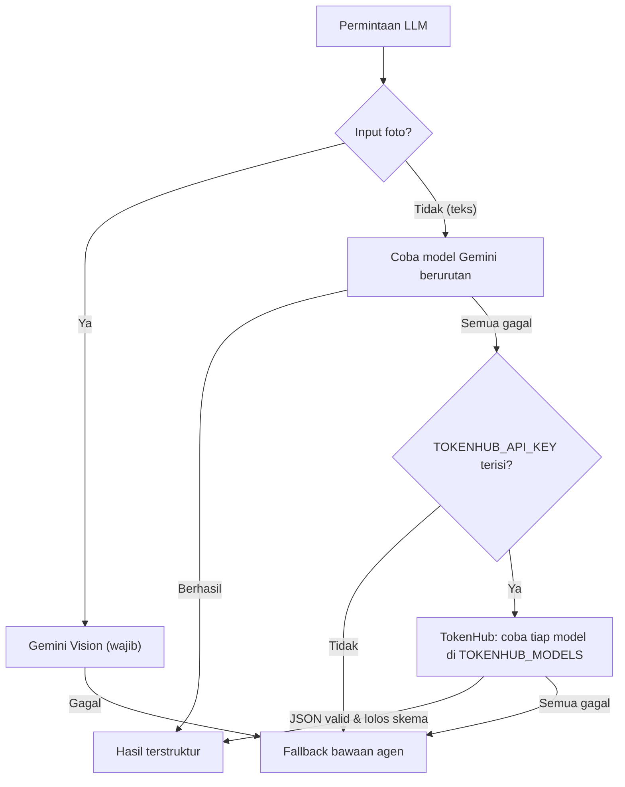

# 📘 Dokumentasi Terbaru: TaniPintar Bot

**Proyek:** TaniPintar — WhatsApp AI Assistant Perlindungan Tanaman Cabai & Padi
**Pembaruan Terakhir:** 17 November 2026
**Cakupan:** Perubahan sejak `docs/arsitektur.md` v2.0 (4 November 2026), yaitu commit `d721f79` (hardening webhook & deployment VPS) dan `46c5427` (cadangan LLM TokenHub).

> Dokumen ini adalah **addendum terbaru**. Untuk arsitektur dasar (LangGraph 14 node, Dual-RAG, ERD) tetap rujuk [arsitektur.md](arsitektur.md); untuk metrik rujuk [metrics.md](metrics.md).

---

## 📑 Daftar Isi

1. [Ringkasan Perubahan](#1-ringkasan-perubahan)
2. [Cadangan LLM TokenHub](#2-cadangan-llm-tokenhub)
3. [Hardening Keamanan Webhook & Media](#3-hardening-keamanan-webhook--media)
4. [Perubahan Deployment (Docker & VPS)](#4-perubahan-deployment-docker--vps)
5. [Perubahan Router Intent](#5-perubahan-router-intent)
6. [Ingestion Knowledge Base dari PDF](#6-ingestion-knowledge-base-dari-pdf)
7. [Referensi Environment Variable](#7-referensi-environment-variable)
8. [Catatan Operasional](#8-catatan-operasional)

---

## 1. Ringkasan Perubahan

| Area | Perubahan | File utama |
|------|-----------|-----------|
| Ketahanan LLM | Cadangan TokenHub (Tencent Cloud) untuk permintaan **teks** bila semua model Gemini gagal | `services/llm_fallback.py`, `agents/diagnosis_agent.py`, `agents/fertilizer_agent.py`, `core/config.py` |
| Keamanan | Verifikasi `X-Hub-Signature-256` webhook Meta, anti-SSRF unduhan media, batas ukuran media, error generik ke klien | `api/routes/whatsapp.py`, `services/whatsapp_service.py` |
| Privasi | Path foto di Supabase Storage memakai hash nomor HP, bukan nomor mentah | `services/storage_service.py` |
| Produksi | `/docs`, `/redoc`, `/openapi.json` dimatikan saat `APP_ENV=production` | `api/app.py` |
| Deployment | Port dibind ke `127.0.0.1`, kontainer non-root, tanpa mount kode, rotasi log, skrip setup Lighthouse | `docker-compose.yml`, `Dockerfile`, `scripts/deploy_lighthouse.sh` |
| Routing | Gejala spesifik penyakit diprioritaskan ke Diagnosis Agent; keyword pupuk dipersempit | `graph_builder.py` |
| Knowledge base | 26 entri SOP & artikel ilmiah dari PDF di `artikel/` | `data/ingest_pdf_articles.py`, `data/knowledge/sop_and_scientific_articles.json` |

---

## 2. Cadangan LLM TokenHub

### Tujuan
Bot sebelumnya mengembalikan jawaban gagal/templat bila seluruh model Gemini terkena limit (HTTP 429) atau error 5xx. Kini ada jalur cadangan melalui **Tencent Cloud TokenHub** (API kompatibel OpenAI Chat Completions).

### Alur



### Perilaku penting
- **Hanya teks.** Diagnosis foto dan embedding tetap memakai Gemini. Di `diagnosis_agent.py` fallback dijalankan hanya jika `contents` bertipe `str`.
- **Dipakai oleh:** `DiagnosisAgent` (diagnosis teks) dan `FertilizerAgent` (rekomendasi pupuk).
- **Keluaran terstruktur.** `llm_fallback.generate_structured(prompt, schema)` menyertakan JSON Schema Pydantic di system prompt, memanggil `POST {TOKENHUB_BASE_URL}/chat/completions` (`temperature=0.2`, `max_tokens=2048`), membersihkan code fence ` ```json `, lalu memvalidasi dengan `schema.model_validate`.
- **Aman bila nonaktif.** `is_enabled()` bernilai `False` jika `TOKENHUB_API_KEY` kosong, sehingga fungsi mengembalikan `None` dan perilaku lama dipertahankan.
- **Toleran terhadap kegagalan.** Setiap model dicoba berurutan; status non-200, JSON tidak valid, atau skema tidak cocok hanya dicatat sebagai warning lalu lanjut ke model berikutnya.

---

## 3. Hardening Keamanan Webhook & Media

### 3.1 Webhook Meta Cloud API
`verify_meta_signature()` memverifikasi header `X-Hub-Signature-256` (HMAC SHA-256 dengan `META_APP_SECRET`, dibandingkan via `hmac.compare_digest`).

| Kondisi | Production | Development |
|---------|-----------|-------------|
| `WHATSAPP_PROVIDER` ≠ `meta` | Ditolak (401) | Diproses |
| `META_APP_SECRET` kosong | Ditolak (fail-closed) | Diizinkan |
| Header signature hilang/salah | Ditolak (401) | Ditolak (401) bila secret diset |

### 3.2 Unduhan Media (anti-SSRF)
`WhatsAppService.download_media()`:
- Hanya mengunduh dari host WAHA sendiri: `_is_waha_url()` mewajibkan skema, host, dan port identik dengan `WAHA_BASE_URL`, serta tanpa kredensial di URL.
- Awalan `localhost:3000` / `127.0.0.1:3000` dipetakan ke `WAHA_BASE_URL` agar jalan antar-kontainer.
- `follow_redirects=False` agar header `X-Api-Key` tidak bocor lewat redirect.
- Batas ukuran **20 MB** (`MAX_MEDIA_BYTES`).
- `media_id` Meta wajib numerik (`^\d{1,30}$`).

### 3.3 Lainnya
- Respons error webhook kini generik (`"Internal error"`); detail hanya di log (`exc_info=True`).
- Foto disimpan di Storage dengan path `sha256(nomor)[:16]/<uuid>.jpg` dan aman bila Supabase belum dikonfigurasi (mengembalikan `None`).
- Endpoint admin tetap terkunci bila `ADMIN_API_KEY` kosong.

---

## 4. Perubahan Deployment (Docker & VPS)

### `docker-compose.yml`
- Bot: `127.0.0.1:8000:8000`; WAHA: `127.0.0.1:3000:3000`. Tidak ada port yang terbuka ke internet. Dashboard WAHA diakses lewat SSH tunnel:
  ```bash
  ssh -L 3000:localhost:3000 user@IP_VPS
  ```
  lalu buka `http://localhost:3000/dashboard`.
- `APP_ENV=production` dipaksa pada kontainer bot.
- Kode **tidak lagi di-mount**; ubah kode lalu jalankan:
  ```bash
  docker compose up -d --build
  ```
- Volume tetap: `./logs` dan `./data`.
- Default `WAHA_DASHBOARD_NO_PASSWORD` dan `WAHA_NO_API_KEY` kini `False` (auth aktif).
- Rotasi log `json-file`: maks 10 MB × 3 file per kontainer.

### `Dockerfile`
Aplikasi berjalan sebagai user non-root `appuser` (UID 1000) agar cocok dengan pemilik folder `logs/` dan `data/` di VPS.

### `scripts/deploy_lighthouse.sh`
Setup otomatis di Tencent Lighthouse (RAM 2 GB):
1. Membuat swap 3 GB bila belum ada.
2. Memasang Docker bila belum ada.
3. Clone repo ke `/opt/tanipintar` bila belum ada.
4. Menyalin `.env.example` → `.env` bila `.env` belum ada (isi API key manual).
5. `docker compose up -d --build` dan menampilkan status kontainer.

> ⚠️ Skrip menampilkan URL `http://<IP>:3000/dashboard` dan `:8000/health`. Karena port kini hanya `127.0.0.1`, URL itu tidak dapat diakses langsung dari luar; gunakan SSH tunnel atau reverse proxy HTTPS (Caddy/Nginx) bila memakai Meta Cloud API.

### `api/app.py`
Swagger (`/docs`), Redoc (`/redoc`), dan `/openapi.json` hanya aktif di luar production.

---

## 5. Perubahan Router Intent

Pada `router_node` di `graph_builder.py`:
- Pengecekan **gejala spesifik** dipindah ke depan blok pupuk. Jika pesan memuat salah satu kata gejala, intent langsung `diagnosis` (SOP RAG + rotasi pestisida).
- Daftar gejala ditambah: `kutu kebul`, `thrips`, `sundep`, `beluk`, `tungro`.
- Keyword pupuk dipersempit untuk mengurangi salah rute: `"dosis"` → `"dosis pupuk"`; ditambah `takaran pupuk`, `pupuk dasar`, `pupuk susulan`, `kocor`; kata generik `obat`, `pestisida`, `fungisida`, `insektisida`, `bakterisida`, `semprot apa` dihapus dari daftar pupuk (kini ditangani jalur diagnosis).

Urutan prioritas (ringkas): harga → cuaca → **gejala spesifik (diagnosis)** → pupuk → sapaan.

---

## 6. Ingestion Knowledge Base dari PDF

`data/ingest_pdf_articles.py` menyusun korpus dari dokumen di `artikel/`:

| Sumber | Isi |
|--------|-----|
| SOP Cabai Merah 2014 (Balitsa/Kementan) | Persemaian, lahan, pemupukan, OPT |
| FRAC Code List 2025 | Mode of action fungisida, rotasi resistensi |
| IRAC MoA Brochure Ed. 6 | Mode of action insektisida |
| Permentan No. 13/2022 | Dosis NPK spesifik lokasi padi sawah |

Proses: bangun entri → buat embedding 768 dimensi (`gemini-embedding-001`) → lewati entri yang `disease_name`-nya sudah ada di `knowledge_base` → `insert` ke Supabase. Hasil JSON tersimpan di `data/knowledge/sop_and_scientific_articles.json`.

```bash
python data/ingest_pdf_articles.py
```

---

## 7. Referensi Environment Variable

| Variabel | Default | Keterangan |
|----------|---------|-----------|
| `APP_ENV` | `development` | Dipaksa `production` oleh docker-compose |
| `GEMINI_API_KEY`, `GEMINI_MODEL`, `EMBEDDING_MODEL` | — / `gemini-3.5-flash` / `gemini-embedding-001` | LLM & embedding utama |
| `TOKENHUB_API_KEY` | kosong | Kosong = cadangan nonaktif |
| `TOKENHUB_BASE_URL` | `https://tokenhub-intl.tencentcloudmaas.com/v1` | Endpoint kompatibel OpenAI |
| `TOKENHUB_MODELS` | `hy4,deepseek-v4.1-flash` | Daftar model, dicoba berurutan |
| `TOKENHUB_TIMEOUT_SECONDS` | `30` | Timeout per model (hanya di `core/config.py`, belum ada di `.env.example`) |
| `SUPABASE_URL`, `SUPABASE_SERVICE_ROLE_KEY`, `SUPABASE_BUCKET_NAME` | — / — / `crop-symptoms` | Database, pgvector, Storage |
| `WHATSAPP_PROVIDER` | `waha` | `waha` atau `meta` |
| `WAHA_BASE_URL`, `WAHA_SESSION`, `WAHA_API_KEY`, `WAHA_HMAC_SECRET` | — | Gateway WAHA |
| `WAHA_DASHBOARD_USERNAME`, `WAHA_DASHBOARD_PASSWORD` | `admin` / — | Login dashboard |
| `META_APP_SECRET` | kosong | Wajib bila provider `meta` di production |
| `META_WA_PHONE_NUMBER_ID`, `META_WA_ACCESS_TOKEN`, `META_WA_VERIFY_TOKEN` | — | Meta Cloud API |
| `REDIS_URL` | kosong | Cache & de-duplikasi (opsional) |
| `CONFIDENCE_THRESHOLD` | `0.70` | Ambang guardrail diagnosis |
| `ADMIN_API_KEY` | kosong | Kosong = endpoint admin terkunci |
| `WEATHER_API_KEY` | — | WeatherAPI.com |

---

## 8. Catatan Operasional

- **Deploy ulang setelah ubah kode:** `docker compose up -d --build` (kode ada di image, bukan volume).
- **Cek fallback TokenHub:** cari log `[TokenHub]` di `logs/`; `Jawaban cadangan berhasil` menandakan fallback sukses, `Semua model cadangan TokenHub gagal` menandakan kedua jalur gagal.
- **Docs lama yang mungkin usang:** `deploy.md` (masih berbasis port publik & mount kode) dan `arsitektur.md` (tanggal 4 Nov) belum memuat perubahan di atas; dokumen ini yang menjadi acuan terbaru.
- **Belum ada test otomatis** untuk `llm_fallback` maupun `verify_meta_signature`; direkomendasikan ditambahkan di `tests/`.
