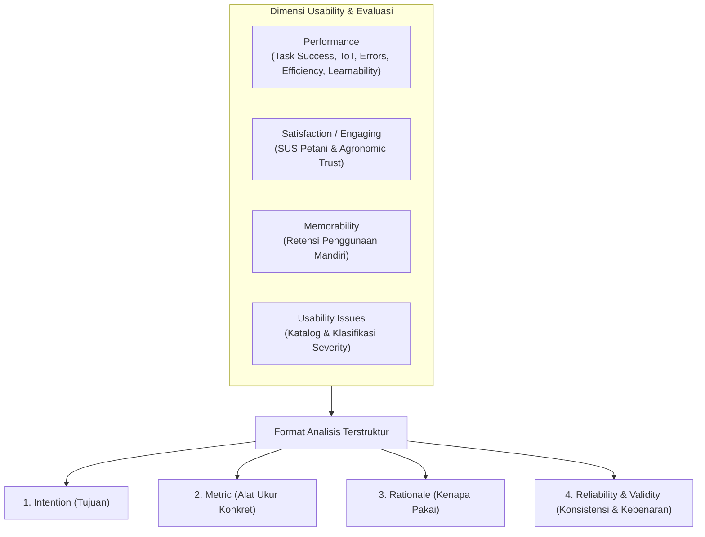

# 📋 Kerangka Evaluasi Pengguna & Usability Engineering (User Testing & Metrics Framework)
## TaniPintar Bot: Asisten Pertanian Berbasis WhatsApp

> **Dokumen Panduan Pengujian Lapangan & Standar Evaluasi Antarmuka Pengguna**  
> **Landasan Teori:** *Usability Engineering (Jakob Nielsen)* & *5Es of Usability (Whitney Quesenbery)*  
> **Komoditas Fokus:** Cabai (*Capsicum annuum*) & Padi (*Oryza sativa*)  
> **Subjek Uji:** 10 Petani Komoditas Tunggal (Kelompok Tani Sasaran)  
> **Model Pengujian:** *Hybrid Evaluation* (Workshop Terbimbing + Uji Coba Mandiri 3–7 Hari + Evaluasi Akhir)

---

## 🧭 1. Perencanaan Studi Pengujian (Study Setup Dimensions)

Evaluasi antarmuka dan kinerja sistem dirancang secara sistematis dengan mempertimbangkan kondisi sosiologis, lingkungan kerja lapangan, dan kapabilitas gawai petani pedesaan.

### 1.1 Goal (Tujuan Penelitian & Pengujian)
- **Tujuan Utama:** Mengukur sejauh mana sistem TaniPintar Bot dapat digunakan secara **Efektif** (*Task Success*), **Efisien** (*Time on Task* & *Keystroke Ratio*), **Toleran terhadap Kesalahan** (*Error Tolerance*), **Mudah Dipelajari** (*Learnability* & *Memorability*), serta **Memuaskan dan Menarik** (*Satisfaction / Engaging*) bagi petani cabai dan padi.
- **Tujuan Khusus:** Menilai kepercayaan petani terhadap diagnosis penyakit multimodal vision, kesesuaian dosis pupuk berimbang, transparansi harga pasar harian, dan kepatuhan terhadap rekomendasi jam semprot aman berbasis cuaca mikro.

### 1.2 Schedule (Jadwal Pelaksanaan)
Pengujian lapangan terstruktur selama **3 Minggu** yang dimulai pada **Minggu Depan**:

| Periode | Fase Pengujian | Aktivitas Utama | Output / Target |
| :--- | :--- | :--- | :--- |
| **Minggu 1** | **Persiapan & Workshop Terbimbing (On-site / Moderated)** | Koordinasi dengan ketua kelompok tani; sosialisasi santai di saung tani; eksekusi 5 skenario tugas terpandu bersama 10 petani; pencatatan awal *Task Success* dan *Time on Task*. | Data observasi awal 10 responden & identifikasi kendala antarmuka pertama. |
| **Minggu 2** | **Uji Mandiri Lapangan (Remote / Unmoderated)** | Petani menggunakan bot secara mandiri selama 3–7 hari di kebun/sawah saat mendapati gejala hama, memantau cuaca sebelum semprot, dan mengecek harga jual pasar. | Log percakapan alami di basis data audit & pengukuran *Memorability*. |
| **Minggu 3** | **Evaluasi Akhir & Pelaporan (On-site / Exit Interview)** | Kunjungan kembali ke kelompok tani; pengisian kuesioner SUS Adaptasi Bahasa Petani; kuesioner kepuasan agronomi (Likert 1–5); wawancara mendalam (*exit interview*); rekapitulasi data metrik. | Laporan rekapitulasi nilai SUS, daftar *Usability Issues*, dan rekomendasi perbaikan (P0, P1, P2). |

### 1.3 Budget (Alokasi Anggaran)
- **Status:** **Zero Budget / Riset Mandiri Swadaya**.
- Pengujian mengoptimalkan infrastruktur lokal yang sudah ada: memanfaatkan balai/saung pertemuan rutin kelompok tani, gawai pintar pribadi milik petani responden, serta paket data/WiFi yang telah terpasang. Tidak dialokasikan anggaran kompensasi khusus yang berpotensi membiaskan objektivitas penilaian petani.

### 1.4 Lab vs Field (Justifikasi Pengujian Lapangan)
- **Pilihan:** **Field Study (Pengujian Lapangan di Saung & Lahan Pertanian)**.
- **Alasan Ilmiah:** Pengujian di laboratorium komputer buatan (*lab testing*) tidak mampu merefleksikan kondisi kerja riil petani:
  1. *Pencahayaan Alami:* Kamera gawai petani diuji di bawah sinar matahari langsung, kondisi mendung, maupun bayangan daun, yang menguji ketangguhan *OpenCV Quality Gatekeeper* secara nyata.
  2. *Kondisi Fisik Pengguna:* Petani sering kali mengoperasikan ponsel dengan tangan kotor atau basah, sehingga pengujian *shortcut* angka 1–6 sangat krusial diuji di lapangan.
  3. *Validitas Ekologis:* Pengambilan keputusan agronomi (percaya atau ragu terhadap dosis pupuk/pestisida) hanya teruji autentik saat petani berada di samping tanamannya.

### 1.5 On-site vs Remote (Justifikasi Model Gabungan)
- **Pilihan:** **Hybrid (On-site Kickoff dilanjutkan Remote Field Usage)**.
- **Alasan Ilmiah:** 
  - *On-site (Saung Tani):* Diperlukan di awal untuk menjembatani kesenjangan literasi teknologi, membantu penyimpanan kontak WhatsApp bot, dan mengamati ekspresi ragu/bingung saat pertama kali memakai sistem.
  - *Remote (Lahan Mandiri):* Diperlukan agar interaksi berlangsung organik tanpa kehadiran pengamat yang menekan (*observer effect*), menguji apakah petani benar-benar mengandalkan bot dalam rutinitas bertani harian.

### 1.6 Moderated vs Unmoderated (Justifikasi Pengawasan Bertahap)
- **Tahap Awal (Moderated):** Sesi 5 skenario tugas dijalankan dengan pendampingan fasilitator pasif guna mengukur *Performance* murni (*Task Success*, *Time on Task*, dan *Assistance Rate*).
- **Tahap Lanjutan (Unmoderated):** Petani bebas bertanya di luar skenario selama sepekan penuh untuk menguji *Error Tolerance* dan *Memorability* saat sistem menghadapi input percakapan bebas tanpa panduan fasilitator.

### 1.7 Ethics (Etika Penelitian & Keselamatan Pengguna)
1. **Informed Consent Bahasa Sederhana:** Menjelaskan secara lisan dan tertulis ramah bahwa bot ini adalah asisten pendukung keputusan (*decision-support tool*), bukan pengganti mutlak pakar pertanian. Partisipasi bersifat sukarela.
2. **Perlindungan Privasi Data:** Nomor telepon petani disamarkan (*masked* / dianonimkan, misal: `0812****5678` $\to$ `P-01`) pada seluruh publikasi laporan, dan foto tanaman hanya digunakan untuk kepentingan pengujian model AI.
3. **Etika Keselamatan Agronomi (Safety Guardrail):** Jika bot mengalami keraguan diagnosis (skor keyakinan $< 0.70$), sistem **dilarang keras berspekulasi** atau merekomendasikan bahan kimia berbahaya. Bot secara otomatis merujuk kasus ke Petugas Penyuluh Lapangan (PPL) setempat demi mencegah malpraktik dosis dan kerugian ekonomi petani.

---

## 📊 2. Matriks Metrik Evaluasi: Intention, Metric, Rationale, Reliability & Validity

Setiap parameter evaluasi dijabarkan secara rinci sesuai format:  
$$\text{\textbf{Intention}} \longrightarrow \text{\textbf{Metric}} \longrightarrow \text{\textbf{Kenapa Pakai Metrik Ini?}} \longrightarrow \text{\textbf{Kenapa Reliabel \& Valid?}}$$

---

### 2.1 Dimensi Kinerja (Performance Metrics)

#### A. Task Success (Effective)
- **Intention (Maksud Pengujian):** Mengukur apakah petani dapat menuntaskan kebutuhan intinya (mendapat diagnosis penyakit, takaran pupuk berimbang, info harga, dan jam semprot cuaca) tanpa mengalami kegagalan sistemik.
- **Metric:** **Task Completion Rate (TCR)**. Dihitung sebagai persentase tugas yang selesai secara benar tanpa intervensi fasilitator:
  $$TCR = \left( \frac{\text{Jumlah Tugas Selesai Sukses}}{\text{Total Tugas yang Diberikan}} \right) \times 100\% \quad (\text{Target} \ge 85\%)$$
- **Kenapa Pakai Metrik Ini? (Rationale):** Sesuai prinsip *Effective* (Whitney Quesenbery): jika petani tidak berhasil mendapatkan informasi yang dicari, kecepatan respons atau keindahan pesan WhatsApp tidak lagi memiliki arti.
- **Kenapa Reliabel & Valid?**
  - *Valid:* Mengukur secara langsung pencapaian tujuan fungsional pengguna tanpa asumsi teoretis.
  - *Reliabel:* Kriteria sukses didefinisikan secara biner (1 = Sukses Mandiri, 0 = Gagal/Menyerah) yang konsisten dinilai oleh siapa pun pengamatnya.

#### B. Time on Task (Efficient)
- **Intention (Maksud Pengujian):** Mengukur kecepatan interaksi petani dari mengirimkan pesan awal hingga mendapatkan instruksi solusi yang dapat dipahami.
- **Metric:** **ToT (Time on Task)** dalam satuan detik/menit per skenario tugas. Target: Median ToT $< 120$ detik per tugas.
- **Kenapa Pakai Metrik Ini? (Rationale):** Petani di lapangan memiliki jendela perhatian terbatas dan sering terburu-buru mengurus lahan; interaksi bot yang lambat atau bertele-tele akan segera ditinggalkan pengguna.
- **Kenapa Reliabel & Valid?**
  - *Valid:* Menangkap durasi kognitif membaca, mengetik, serta latensi teknis sistem secara menyeluruh.
  - *Reliabel:* Waktu dicatat secara objektif menggunakan pencatatan waktu berpresisi detik dan diverifikasi silang dengan *timestamp* riwayat percakapan WhatsApp.

#### C. Errors & Error Tolerance (Error Tolerant)
- **Intention (Maksud Pengujian):** Mengukur frekuensi kesalahan yang dilakukan petani saat berinteraksi, serta menguji seberapa ramah dan tangguh bot dalam memandu pemulihan kesalahan (*error recovery*) tanpa terjadi kebuntuan (*deadlock*).
- **Metric:**
  1. *Error Frequency:* Rata-rata frekuensi salah input nomor/salah kirim per tugas (Target $\le 1$ kesalahan per 5 tugas).
  2. *Error Recovery Rate:* Persentase petani yang berhasil kembali ke alur yang benar setelah mendapat pesan peringatan dari bot (Target $100\%$).
  3. *Catastrophic Error Prevention:* Toleransi terhadap bahaya racun pestisida (Target $0$ insiden salah dosis bahan aktif berkat *hard guardrail* ambang batas 0.70).
- **Kenapa Pakai Metrik Ini? (Rationale):** Petani dengan keterbatasan literasi digital sering melakukan kesalahan pengetikan atau mengirimkan foto yang tidak jelas. Uji sejati antarmuka bukanlah ketiadaan kesalahan, melainkan bagaimana sistem menolong saat kesalahan terjadi (*Error Tolerant*).
- **Kenapa Reliabel & Valid?**
  - *Valid:* Memisahkan antara kesalahan operasional pengguna (*slips/mistakes*) dengan kegagalan arsitektur perangkat lunak.
  - *Reliabel:* Kejadian eror dicatat otomatis pada basis data log audit (misal: *flag* `is_referred_to_ppl` atau foto ditolak oleh filter Laplacian OpenCV).

#### D. Efficiency (Productivity & Keystroke Optimization)
- **Intention (Maksud Pengujian):** Mengukur peningkatan produktivitas petani saat menggunakan *shortcut* numerik angka (1–6) dibanding mengetik kalimat panjang secara manual.
- **Metric:** **Keystroke & Typo Reduction Rate**. Persentase navigasi menu yang berhasil dieksekusi hanya dengan 1 karakter angka (Target $\ge 80\%$) dan tingkat reduksi kesalahan ketik ($\ge 90\%$).
- **Kenapa Pakai Metrik Ini? (Rationale):** Mengetik kalimat panjang pada papan ketik layar sentuh berukuran kecil menyulitkan petani pedesaan, terutama petani senior.
- **Kenapa Reliabel & Valid?**
  - *Valid:* Mengukur secara langsung penurunan beban motorik dan kognitif pengetikan.
  - *Reliabel:* Panjang karakter input tercatat secara matematis pada log pesan inbound HTTP webhook.

#### E. Learnability (Easy to Learn)
- **Intention (Maksud Pengujian):** Mengukur kemudahan petani pemula dalam memahami cara mengoperasikan bot pada pertemuan pertama tanpa pelatihan formal yang rumit.
- **Metric:** **Time-to-First-Success (TTFS)**. Waktu yang dibutuhkan petani sejak membuka nomor bot hingga berhasil memunculkan menu layanan utama pada Tugas 1 (Target $\le 60$ detik).
- **Kenapa Pakai Metrik Ini? (Rationale):** Sesuai prinsip *Easy to Learn* (Nielsen & Quesenbery): asisten publik harus dapat langsung digunakan sejak menit pertama tanpa mewajibkan petani membaca buku petunjuk penggunaan yang tebal.
- **Kenapa Reliabel & Valid?**
  - *Valid:* Mengukur kurva adaptasi mental awal (*initial mental model alignment*).
  - *Reliabel:* Diuji secara serentak pada kondisi awal yang sama (*first exposure*) sebelum petani mendapatkan pembiasaan.

#### F. Memorability
- **Intention (Maksud Pengujian):** Menguji apakah petani yang tidak membuka bot selama beberapa hari dapat langsung kembali menggunakannya dengan lancar tanpa perlu diajari ulang dari awal.
- **Metric:** **Retention Task Success Rate**. Persentase keberhasilan mengeksekusi tugas mandiri pada Tahap 3 (setelah jeda 3–7 hari penggunaan mandiri) tanpa bantuan fasilitator (Target $\ge 90\%$).
- **Kenapa Pakai Metrik Ini? (Rationale):** Konsultasi pertanian bersifat musiman/insidental (misal: hanya bertanya saat ada serangan hama baru atau saat harga anjlok). Bot harus memiliki struktur yang mudah diingat kembali (*easy to remember*).
- **Kenapa Reliabel & Valid?**
  - *Valid:* Mengukur retensi ingatan fungsional pengguna terhadap antarmuka.
  - *Reliabel:* Periode jeda waktu terstandarisasi seragam (3–7 hari) untuk seluruh responden.

---

### 2.2 Dimensi Kepuasan & Keterlibatan (Satisfaction & Engaging)

#### A. Usability Satisfaction (SUS Adaptasi Petani)
- **Intention (Maksud Pengujian):** Mengukur tingkat kepuasan subjektif pengguna terhadap kenyamanan, keterpaduan fitur, dan kemudahan antarmuka secara keseluruhan.
- **Metric:** **Skor System Usability Scale (SUS)** rentang 0–100 menggunakan 10 butir instrumen yang diadaptasi ke dalam bahasa petani yang lugas dan ramah. **Target: Skor $\ge 70$ (Grade B / Acceptable)**.
- **Kenapa Pakai Metrik Ini? (Rationale):** SUS adalah standar de-facto industri HCI global yang terbukti mampu menangkap persepsi kegunaan secara komparatif dan terstandarisasi.
- **Kenapa Reliabel & Valid?**
  - *Valid:* Instrumen mencakup aspek kecemasan pengguna, efisiensi yang dirasakan, dan keinginan adopsi berulang.
  - *Reliabel:* Memiliki koefisien konsistensi internal yang sangat teruji secara statistik (Cronbach's $\alpha \ge 0.85$).

#### B. Agronomic Trust & Actionability (Engaging)
- **Intention (Maksud Pengujian):** Mengukur apakah petani merasa terlibat (*engaging*), meyakini kebenaran diagnosis, serta bersedia mempraktikkan rekomendasi dosis obat dan jam semprot di lahannya.
- **Metric:** Rata-rata skor Kuesioner Kepuasan & Kepercayaan Agronomi (Skala Likert 1–5). Target rata-rata $\ge 4.0 / 5.0$.
- **Kenapa Pakai Metrik Ini? (Rationale):** Antarmuka yang mudah digunakan tidak ada gunanya jika petani tidak percaya pada substansi nasihat pertanian yang diberikan.
- **Kenapa Reliabel & Valid?**
  - *Valid:* Menilai validitas isi (*content validity*) dari perspektif praktisi budidaya di lapangan.
  - *Reliabel:* Menggunakan skala Likert 5 poin terkalibrasi dengan deskriptor verbal yang jelas.

---

### 2.3 Dimensi Masalah Antarmuka (Usability Issues)
- **Intention (Maksud Pengujian):** Mengidentifikasi, mengatalogkan, dan menentukan prioritas perbaikan atas setiap friksi, kebingungan, atau kegagalan yang dialami pengguna selama berinteraksi dengan bot.
- **Metric:** **Tingkat Keparahan Masalah (Severity Rating)** berdasarkan skala standar Usability Engineering:

| Tingkat Keparahan (*Severity*) | Definisi Operasional di Lapangan | Target Toleransi |
| :--- | :--- | :---: |
| **4 - Fatal / Catastrophic** | Sistem macet (*deadlock*), bot berhenti merespons, atau memberikan rekomendasi takaran pestisida overdosis yang membahayakan tanaman. | **0 Insiden** |
| **3 - Mayor (Major)** | Petani gagal menyelesaikan tugas mandiri karena kebingungan memahami menu, atau foto tanaman berulang kali ditolak tanpa alasan yang jelas. | $< 10\%$ Skenario |
| **2 - Minor (Minor)** | Petani ragu-ragu sesaat atau salah mengetik nomor menu, namun mampu memperbaiki diri secara mandiri dalam waktu singkat. | Toleransi Wajar |
| **1 - Kosmetik (Cosmetic)** | Penulisan kata yang kurang pas, format teks tebal yang terlalu padat, atau jeda waktu balas yang sedikit lebih lama dari biasanya. | Dicatat untuk P2 |

---

## 🧪 3. Modul Skenario Uji Tugas Lapangan (Task Scenarios)

### 🌶️ Paket A: Skenario Petani Cabai

| No | Atribut Usability yang Diuji | Instruksi Pengujian untuk Petani | Respon yang Diharapkan dari Bot | Kriteria Sukses (Pass) |
| :---: | :--- | :--- | :--- | :--- |
| **T1** | *Learnability & Efficiency* | *"Kirim pesan salam seperti 'Halo' ke bot, lalu coba buka menu daftar penyakit cabai."* | Bot membalas ramah, menyajikan menu angka 1–6, dan menampilkan 6 penyakit cabai. | Menu muncul mandiri dalam waktu $< 60$ detik. |
| **T2** | *Effective & Error Tolerant* | *"Kirimkan 1 foto daun cabai yang bergejala keriting atau bercak patek ke bot."* | OpenCV memvalidasi foto; Gemini mengidentifikasi patogen dan 3 pilar solusi pengendalian. | Diagnosis keluar akurat dan dipahami petani. |
| **T3** | *Actionability & Satisfaction* | *"Tanyakan ke bot: 'Cabai umur 40 hari bunganya rontok, pupuk apa yang bagus?'"* | Bot menyarankan formulasi generatif MKP + Kalsium Boron serta anjuran rotasi seimbang. | Petani memahami takaran dan waktu aplikasi. |
| **T4** | *Utility & Clarity* | *"Cek berapa harga cabai rawit merah dan cabai keriting di pasar lokal hari ini."* | Bot menampilkan perbandingan harga petani vs pasar acuan PIHPS terkini. | Angka harga terbaca jelas dan mudah dipahami. |
| **T5** | *Decision-Support & Safety* | *"Tanyakan perkiraan cuaca dan jam berapa aman menyemprot obat hama hari ini."* | Bot menampilkan ramalan hujan dan jam semprot aman (*Spray Advisory*). | Petani mengetahui jadwal aman tanpa risiko luntur. |

### 🌾 Paket B: Skenario Petani Padi

| No | Atribut Usability yang Diuji | Instruksi Pengujian untuk Petani | Respon yang Diharapkan dari Bot | Kriteria Sukses (Pass) |
| :---: | :--- | :--- | :--- | :--- |
| **T1** | *Learnability & Efficiency* | *"Sapa bot dan pilih nomor menu untuk melihat daftar masalah tanaman padi."* | Bot menyajikan daftar 5 penyakit utama padi (Blas, HDB, Sundep, Tungro, WBC). | Navigasi menu angka tuntas tanpa salah ketik. |
| **T2** | *Effective & Error Tolerant* | *"Kirimkan foto daun padi yang mengering coklat atau bercak belah ketupat ke bot."* | Bot mendeteksi Blas/Kresek, menyarankan sanitasi air sawah dan bahan aktif anjuran. | Petani menerima nama lokal penyakit dan solusinya. |
| **T3** | *Actionability & Satisfaction* | *"Tanyakan: 'Padi saya umur 20 hari, pemupukan susulan pertama pakai apa dan takarannya?'"* | Bot merinci panduan vegetatif aktif (Urea terukur + NPK/SP-36) dan bahaya over-Urea. | Petani menilai takaran pupuk masuk akal dan aman. |
| **T4** | *Utility & Clarity* | *"Cek harga Gabah Kering Panen (GKP) dan Beras Medium setempat hari ini."* | Bot menyajikan data harga acuan GKP per kilogram terkini yang mudah dipahami. | Petani dapat membandingkan harga dengan tengkulak. |
| **T5** | *Decision-Support & Safety* | *"Tanyakan apakah sore ini akan hujan dan jam terbaik menyemprot hama wereng."* | Bot memberikan prakiraan cuaca dan jendela waktu penyemprotan insektisida efektif. | Petani memahami jadwal semprot yang dianjurkan. |

---

## 📝 4. Lembar Instrumen Pengujian Siap Cetak (Print-Ready Forms)

### Form A: Lembar Observasi Kinerja Fasilitator (Performance Log)

- **Kode Responden:** P-____  
- **Usia / Pendidikan:** ____ Tahun / ____________________  
- **Komoditas / Desa:** [ ] Cabai &nbsp; [ ] Padi &nbsp; | Desa: ________________  
- **Kemahiran WhatsApp:** [ ] Pemula &nbsp; [ ] Cukup Terbiasa &nbsp; [ ] Sangat Mahir  

| Tugas | Task Success? (Ya/Tidak) | Frekuensi Eror (Salah Ketik/Input) | Durasi ToT (Menit:Detik) | Usability Issue yang Teramati & Catatan Tingkat Keparahan |
| :---: | :---: | :---: | :---: | :--- |
| **T1 (Menu)** | [ ] Ya &nbsp; [ ] Tidak | ____ kali | ___ : ___ | |
| **T2 (Foto)** | [ ] Ya &nbsp; [ ] Tidak | ____ kali | ___ : ___ | |
| **T3 (Pupuk)** | [ ] Ya &nbsp; [ ] Tidak | ____ kali | ___ : ___ | |
| **T4 (Harga)** | [ ] Ya &nbsp; [ ] Tidak | ____ kali | ___ : ___ | |
| **T5 (Cuaca)** | [ ] Ya &nbsp; [ ] Tidak | ____ kali | ___ : ___ | |

---

### Form B: Kuesioner SUS Adaptasi Bahasa Petani (10 Butir)

> **Petunjuk Pengisian:**  
> Beri tanda centang ($\checkmark$) pada pilihan:  
> **1 = Sangat Tidak Setuju (STS)** | **2 = Tidak Setuju (TS)** | **3 = Ragu-ragu (N)** | **4 = Setuju (S)** | **5 = Sangat Setuju (SS)**

| No | Butir Evaluasi (Bahasa Lugas & Ramah Petani) | 1 (STS) | 2 (TS) | 3 (N) | 4 (S) | 5 (SS) |
| :---: | :--- | :---: | :---: | :---: | :---: | :---: |
| 1 | Saya merasa ingin rutin menggunakan bot WA ini untuk membantu merawat tanaman saya. | [ ] | [ ] | [ ] | [ ] | [ ] |
| 2 | Saya merasa bot WA ini terlalu rumit dan membingungkan untuk digunakan. | [ ] | [ ] | [ ] | [ ] | [ ] |
| 3 | Saya merasa cara membalas dan memilih menu nomor di bot ini sangat mudah dipahami. | [ ] | [ ] | [ ] | [ ] | [ ] |
| 4 | Saya merasa membutuhkan bantuan orang lain setiap kali ingin bertanya ke bot ini. | [ ] | [ ] | [ ] | [ ] | [ ] |
| 5 | Saya merasa fitur-fitur di bot ini (foto penyakit, harga, cuaca, pupuk) tersusun rapi dan pas. | [ ] | [ ] | [ ] | [ ] | [ ] |
| 6 | Saya merasa jawaban dari bot ini sering membingungkan atau tidak konsisten. | [ ] | [ ] | [ ] | [ ] | [ ] |
| 7 | Saya yakin sebagian besar teman-teman sesama petani akan bisa lancar memakai bot ini. | [ ] | [ ] | [ ] | [ ] | [ ] |
| 8 | Saya merasa cara kerja bot ini merepotkan dan canggung saat dibawa ke sawah/kebun. | [ ] | [ ] | [ ] | [ ] | [ ] |
| 9 | Saya merasa tenang dan yakin saat menerima saran obat/pupuk dari bot ini. | [ ] | [ ] | [ ] | [ ] | [ ] |
| 10 | Saya harus belajar banyak hal dulu sebelum bisa lancar memakai bot WhatsApp ini. | [ ] | [ ] | [ ] | [ ] | [ ] |

$$\text{Skor SUS} = \left[ \sum_{i \in \{1,3,5,7,9\}} (\text{Jawaban}_i - 1) + \sum_{j \in \{2,4,6,8,10\}} (5 - \text{Jawaban}_j) \right] \times 2.5$$

---

### Form C: Kuesioner Kepuasan & Kepercayaan Agronomi (Skala Likert 1–5)

| Kode | Aspek yang Diuji | Pernyataan Penilaian Lapangan | 1 (STS) | 2 (TS) | 3 (N) | 4 (S) | 5 (SS) |
| :---: | :--- | :--- | :---: | :---: | :---: | :---: | :---: |
| **K1** | **Kejelasan Bahasa** | Bahasa yang digunakan bot (nama penyakit & pupuk) mudah dimengerti tanpa istilah ilmiah asing yang membingungkan. | [ ] | [ ] | [ ] | [ ] | [ ] |
| **K2** | **Kesesuaian Diagnosis** | Penyakit yang ditebak bot berdasarkan foto sesuai dengan gejala yang biasa kami lihat di tanaman. | [ ] | [ ] | [ ] | [ ] | [ ] |
| **K3** | **Kepraktisan Solusi** | Bahan obat atau pupuk yang disarankan bot mudah dicari dan dibeli di kios pertanian terdekat. | [ ] | [ ] | [ ] | [ ] | [ ] |
| **K4** | **Ketepatan Takaran** | Takaran dosis pupuk dan semprot dari bot masuk akal dan aman untuk keselamatan panen saya. | [ ] | [ ] | [ ] | [ ] | [ ] |
| **K5** | **Manfaat Info Harga** | Informasi harga cabai/padi membantu saya mengetahui kisaran harga jual yang wajar saat bertemu pedagang. | [ ] | [ ] | [ ] | [ ] | [ ] |
| **K6** | **Manfaat Info Cuaca** | Pengingat jam semprot dari bot berguna agar obat yang disemprot tidak luntur terkena air hujan. | [ ] | [ ] | [ ] | [ ] | [ ] |
| **K7** | **Kepercayaan Rujukan PPL** | Saat bot ragu lalu menyarankan konsultasi ke PPL setempat, saya merasa tindakan itu bijak dan tepat. | [ ] | [ ] | [ ] | [ ] | [ ] |

---

### Form D: Log Pelaporan Usability Issues (Katalog Friksi Pengguna)

| ID Isu | Skenario Terkait | Deskripsi Friksi / Kebingungan Petani | Tingkat Keparahan (1–4) | Rencana Solusi Desain (*Fix*) | Status |
| :---: | :---: | :--- | :---: | :--- | :---: |
| UI-01 | T2 (Foto) | Foto daun berulang kali ditolak karena pantulan sinar matahari berlebih di sawah. | **3 (Mayor)** | Berikan tips ringkas cara bayangi daun dengan topi caping sebelum foto. | Open |
| UI-02 | T1 (Menu) | Petani mengetik kata 'satu' bukan angka '1' sehingga bot tidak merespons menu. | **2 (Minor)** | Tambahkan deteksi teks kata bilangan pada router intent regex. | Open |
| UI-03 | T3 (Pupuk) | Petani ragu dengan singkatan pupuk 'MKP' yang belum umum di kios dusun tertentu. | **2 (Minor)** | Tambahkan padanan nama dagang umum (misal: pupuk fosfat-kalium kristal). | Open |

---

## 📈 5. Template Rekapitulasi Data Evaluasi Pengguna (10 Responden)

| ID | Usia | TCR (%) | ToT Median (dtk) | Total Eror | Skor SUS | Grade SUS | Rata-rata Likert (1–5) | Keterangan / Isu Utama |
| :---: | :---: | :---: | :---: | :---: | :---: | :---: | :---: | :--- |
| P-01 | | | | | | | | |
| P-02 | | | | | | | | |
| P-03 | | | | | | | | |
| P-04 | | | | | | | | |
| P-05 | | | | | | | | |
| P-06 | | | | | | | | |
| P-07 | | | | | | | | |
| P-08 | | | | | | | | |
| P-09 | | | | | | | | |
| P-10 | | | | | | | | |
| **Rata-rata** | | **___ %** | **___ dtk** | **___** | **___** | **Grade __** | **___ / 5.0** | |

---

## 💡 6. Rencana Tindak Lanjut Pasca Evaluasi (Action Plan)

1. **Prioritas P0 (Hambatan Fatal/Kritis):**
   - Jika ditemukan kegagalan total foto tanaman ($TCR < 70\%$), segera kalibrasi ambang batas Laplacian filter OpenCV di `graph_builder.py` agar ramah kamera gawai resolusi rendah ($< 8$ MP).
   - Menjamin nol toleransi atas kesalahan dosis racun pestisida dengan penegakan *hard guardrail* ambang batas 0.70.
2. **Prioritas P1 (Penyempurnaan Bahasa & Antarmuka):**
   - Menyingkat balasan teks diagnosis agar tidak melebihi 3 gelembung pesan WhatsApp untuk mencegah kejenuhan membaca di layar kecil.
   - Menyertakan sinonim nama dagang lokal pupuk dan fungisida kios desa.
3. **Prioritas P2 (Skalabilitas & Fitur Lanjutan):**
   - Perancangan masukan suara (*voice note WhatsApp*) dialek bahasa Jawa halus/ngoko untuk merangkul petani sepuh yang memiliki kendala penglihatan atau pengetikan teks.
